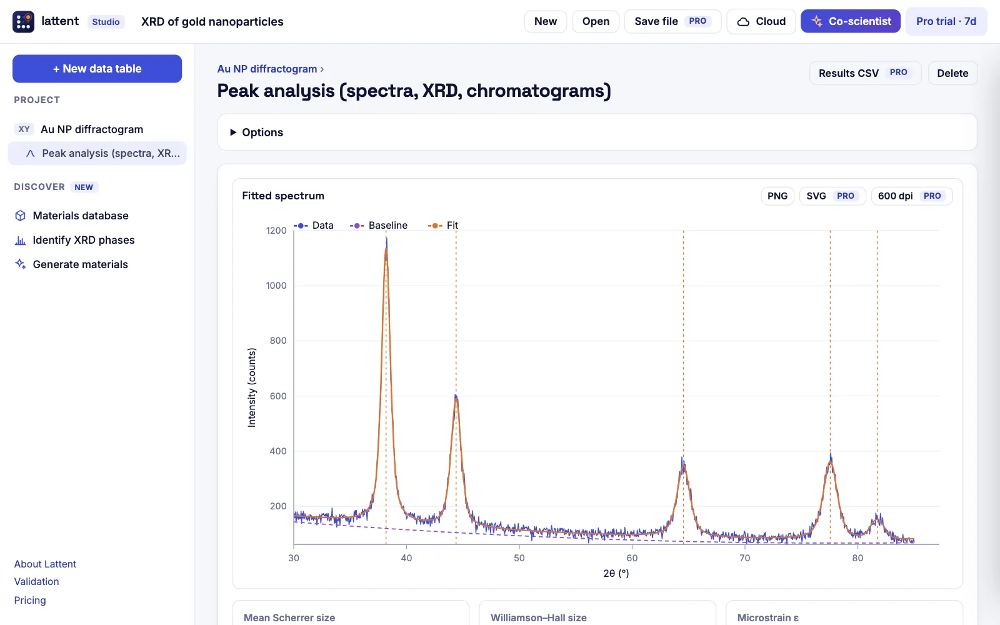

# Lattent

**Data analysis for materials and chemistry, in your browser.** Curve fitting with honest uncertainties, statistics, XRD and spectra, phase identification against 5.8 million computed crystals, and generative design. The numbers are checked against SciPy and the NIST reference datasets on every release, and your data never leaves your computer.

**[Open Lattent Studio →](https://siba-p.github.io/lattent/studio/)** · [Quick tools](https://siba-p.github.io/lattent/tools/) · [Validation](https://siba-p.github.io/lattent/validation/) · [What's new](https://siba-p.github.io/lattent/changelog/)

[](https://github.com/siba-p/lattent/actions/workflows/validate.yml)



Free to use, no installation: open it, paste your data, and share a copy of any project as a link. It can also be installed from the browser as an app that keeps working offline. Built by Sibasankar Panigrahy and Satyendra Rajput (PhD, IIT Delhi). If you use Lattent in published work, please cite it ([CITATION.cff](CITATION.cff)).

## What it does

**Lattent Studio** is a browser workspace for scientific data, in the spirit of GraphPad Prism but for every lab:
- data tables (XY, Column, Multiple variables), filled by pasting, or by opening Excel workbooks and instrument files (CSV, JCAMP-DX, XRDML, RAS, UXD, SPC, CIF), many at a time;
- batch runs: one analysis repeated on every imported file, with the key results collected in one summary table;
- nonlinear regression with 35 equations from materials science, polymers, nanomaterials, chemistry and biology, plus user-defined equations and AICc auto-fit;
- statistics: t tests, ANOVA with Tukey, Kruskal–Wallis, correlation and regression;
- spectra and materials analyses: multi-peak fitting, XRD Scherrer and Williamson–Hall, Tauc band gap, tensile tests;
- PCA, clustering, and Gaussian-process Bayesian optimisation for materials discovery;
- **Discover**: live search of 5.8 million DFT structures (Alexandria, via OPTIMADE) with a 3D viewer and simulated XRD; XRD phase identification; and generative design of new compositions with Lattent's own masked-diffusion model and property networks;
- figures at each journal's exact column width and text size (ACS, RSC, Elsevier, Nature, Wiley), as TIFF, PNG or SVG;
- Facet, the AI lab partner: built-in suggestions, an offline reviewer that checks the whole project for errors, a graph reader that turns a picture of a plot into data, and Claude or GPT chat (with figures) on the user's own key; the validated engine does the computing.

Quick calculators cover routine bench assays: dose–response, standard curves, enzyme kinetics and qPCR.

The analysis is free. Pro adds publication exports, auto-written methods and results, CSV and report export, project files, more cloud storage and the AI chat.

The site is static, hosted on GitHub Pages. The backend runs on Supabase:
- Postgres with row-level security, holding cloud projects, Lab teams, subscriptions and contact enquiries.
- Four Edge Functions: `ls-webhook` (Lemon Squeezy), `rzp-webhook` (Razorpay), `contact` (contact form, forwarded through Resend) and `delete-account`.

Payments go through Lemon Squeezy (worldwide, US dollars, merchant of record) and Razorpay (India, rupees). **To turn on accounts and payments, follow [docs/SETUP.md](docs/SETUP.md).**

Live site: https://siba-p.github.io/lattent/

## Structure

| Path | What it holds |
|---|---|
| `studio/`, `assets/js/studio.js` | The Studio workspace: tables, analysis catalogue, results, Facet |
| `assets/js/models.js` | Equation library, safe expression parser, nonlinear regression and auto-fit |
| `assets/js/analysis.js` | Statistics, PCA, k-means, Gaussian processes and Bayesian optimisation, peaks, XRD, Tauc, tensile |
| `assets/js/samples.js` | Example projects, one per field |
| `assets/js/ml-features.js`, `ml.js`, `assets/models/shape-v1.js` | Lattent's own specialist models (shape recogniser, scatter model), running in the browser |
| `tests/ml/` | Simulator, training script and checks for the specialist models |
| `assets/js/chem.js` | Elements, formula parsing, composition features, charge balance |
| `assets/js/crystal.js` | OPTIMADE client (Alexandria), cell symmetrisation, conventional cells, powder XRD, phase matching, CIF |
| `assets/js/generate.js`, `gen-worker.js`, `assets/models/gen-v1.js` | Generative and property models, run in a Web Worker |
| `assets/js/learn.js`, `learn-worker.js` | Equation discovery (symbolic regression) and AutoML with permutation importance and conformal intervals |
| `ai/`, `assets/js/ai.js` | The AI page: periodic table of Lattent's models and a live lab |
| `assets/js/theme.js` | Applies the saved light or dark theme before the page paints |
| `assets/js/hero.js` | “Lattent in 40 seconds”: the home-page film, a five-step workflow (data in, analyse, features, AI & ML, publish) drawn on a canvas from the worked examples’ numbers; `window.__film.seek(t)` renders one moment for tests and video capture |
| `sw.js`, `manifest.webmanifest` | Installable app; Studio works offline (network first, so updates always arrive when online) |
| `assets/js/discover.js` | Studio's Discover views: database, phase identification, generation, 3D viewer |
| `tests/gen/` | Featurisation, training scripts, bundling and checks for the generative models |
| `tools/`, `scripts/build_tools.py` | Quick-tool pages for materials and chemistry (generated) |
| `assets/js/stats.js` | Levenberg–Marquardt fitting, covariance, t, F, χ² and studentized-range distributions, delta method |
| `assets/js/engines.js` | Analysis engines for the four tools (no DOM access; shared with the tests) |
| `assets/js/plot.js` | SVG charts used both on screen and for exported figures; journal sizes, TIFF and PNG-resolution writers |
| `assets/js/shell.js` | Header and footer, table parsing, exports, write-up panel, Pro licence and trial gate |
| `assets/js/config.js` | Prices, checkout links, store id, support address |
| `dose.js`, `stdcurve.js`, `kinetics.js`, `qpcr.js` | The tool pages |
| `assets/js/cloud.js`, `account.js` | Sign-in, plan, cloud projects, Lab teams, checkout, account deletion |
| `supabase/migrations/` | Database schema, row-level security policies, quotas, team functions |
| `supabase/functions/` | `ls-webhook` and `rzp-webhook` (signed payment events), `contact` and `delete-account`; shared, unit-tested logic in `_shared/` |
| `scripts/` | One-command backend deployment, site configuration, page generators (`build_tools.py`, `build_solutions.py`, which also run `seo.py` for canonical URLs, social cards and structured data), app icons, rebranding and `set-domain.py` for moving to a custom domain |
| `tests/` | Validation against SciPy; file import (including Excel); figure sizes and image writers; share-link format; database security and webhook tests (`npm run test:db`) |

It is a static site with no build step. To serve it locally, run `python3 -m http.server` and open http://localhost:8000.

## Specialist models

Facet's suggestions and shape-guided auto-fit use two small neural networks trained on simulated lab data. The training set covers 13 families of behaviour, with realistic ranges, spacings, replicates, outliers and noise. To retrain:

```bash
for k in 1 2 3 4; do node tests/ml/simulate.js 1300 $((k*7919)) /tmp/ml/train$k.json & done
node tests/ml/simulate.js 600 424242 /tmp/ml/test.json; wait
python tests/ml/train.py /tmp/ml assets/models/shape-v1.js      # needs scikit-learn
node tests/ml/check.js                                         # parity and realistic cases
```

## Generative models

Discover's models are trained on Materials Project data from Matbench (`matbench_mp_e_form`, `matbench_mp_gap`; CC BY 4.0):

- **Formation energy:** the most stable polymorph per composition. Test MAE is 0.092 eV/atom.
- **Band gap:** test MAE is 0.32 eV.
- **Generator:** a masked discrete-diffusion model over (element, count) slots.

```bash
python tests/gen/extract_matbench.py matbench_mp_e_form.json.gz eform.json   # also matbench_mp_gap → gap.json
node tests/gen/featurize.js eform.json <dir>/eform_f                      # composition features (same code as the browser)
python tests/gen/train_props.py <dir> props.json tests/gen/props_parity.json
python tests/gen/train_mdiff.py <dir> mdiff.json report.json
python tests/gen/bundle.py props.json mdiff.json assets/models/gen-v1.js
node tests/gen/check.js tests/gen/props_parity.json                      # parity and behaviour
node tests/gen/check_xtal.js                                              # XRD and phase ID (live database)
```

Data credits:
- Materials Project (Jain et al., *APL Materials* 2013);
- Matbench (Dunn et al., *npj Comput. Mater.* 2020);
- Alexandria (Schmidt et al., *Sci. Data* 2022; *Adv. Mater.* 2023).

## Validation

```bash
node tests/run-engines.js /tmp/bf.json && python tests/check_scipy.py /tmp/bf.json      # calculators
node tests/run-studio.js /tmp/st.json && python tests/check_studio.py /tmp/st.json      # Studio engine
node tests/ml/check.js && node tests/ml/check_learn.js                                  # specialist models, AutoML
node tests/gen/check.js tests/gen/props_parity.json && node tests/gen/check_xtal.js --offline
node tests/formats/check.js && node tests/bench/nist.js --check                         # file import, NIST StRD
node tests/share/check.js && node tests/figure/check.js                                 # share links, journal-size figures
node tests/guide/check.js                                                               # on-site help guide
npm ci && npm run test:db                                                               # database security, both payment webhooks
```

Node 22.6 or later is needed (the database tests load TypeScript directly), plus Python with NumPy and SciPy. GitHub Actions runs all of these on every push; run them before every release. Every check must pass.

## Licence keys (legacy, optional)

Plans are tied to accounts (docs/SETUP.md), and that is the path to use: do **not** enable licence keys on the account-based products. The browser still accepts Lemon Squeezy licence keys, which is useful only if you ever sell without accounts. In that case:

1. Create a store at lemonsqueezy.com and complete identity and payout verification. Lemon Squeezy is the merchant of record, so it collects and remits VAT, GST and US sales tax.
2. Create one product, **Lattent Pro**, with three variants:
   - Monthly subscription, $4.
   - Yearly subscription, $29.
   - **Lab** yearly subscription, $299.
3. On each variant, enable **License keys**. Set the activation limit to 3 for Pro and 10 for Lab, and set the key length to match the subscription.
4. Copy each variant's checkout link (Share → Checkout link) and the numeric store id (Settings → Stores) into `assets/js/config.js`:
   ```js
   checkout: { monthly: 'https://…', yearly: 'https://…', lab: 'https://…' },
   storeId: 12345,
   support: 'support@your-domain',
   ```
5. In the product's confirmation email, tell the customer to paste their key at `/account/`.

Licence keys are checked in the browser against Lemon Squeezy's public licence API, so no server is needed. The Pro gate runs on the client, so a determined user could bypass it. That is an accepted trade-off for this audience: there are no servers to run and no customer data to hold.

© Lattent. All rights reserved.
